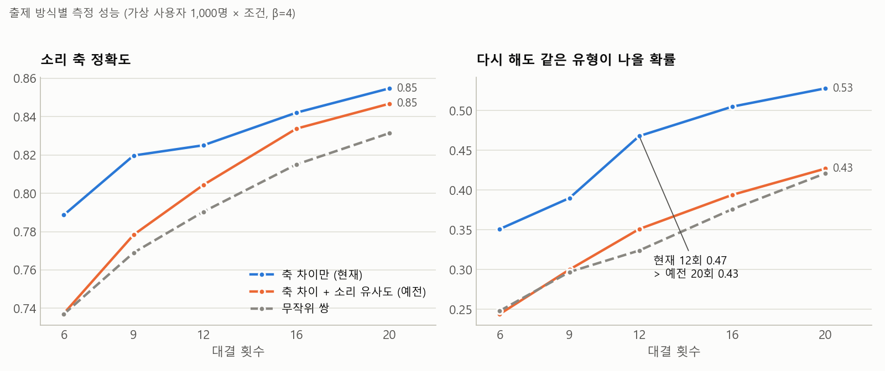
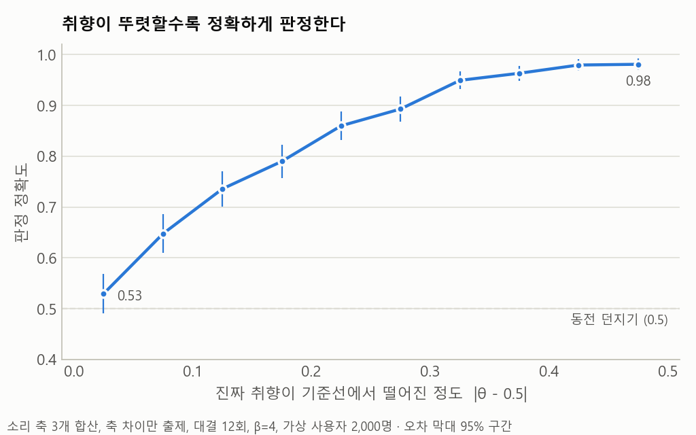

# 시뮬레이션으로 본 테스트의 측정 성능

진짜 취향을 아는 가상 사용자 2,000명에게 테스트를 풀게 하고, 판정이 맞는지 확인했습니다.
페이지의 출제(`nextPair`), 채점(`score`), 유형 판정을 그대로 옮겼습니다.

- `sim.py` 시뮬레이션과 표 출력 (`sim_result.txt`)
- `plot.py` 아래 그림 두 장

## 가상 사용자

- 소리 축 3개(신남, 대중, 최신)마다 진짜 위치 θ를 0~1에서 고릅니다. 0.5보다 크면 그쪽을 좋아하는 사람입니다.
- 장르 취향 방향도 하나씩 줍니다. 사람은 축만 보고 고르지 않으니, 이것이 측정을 방해하는 잡음 역할을 합니다.
- 두 곡 중 하나를 고를 확률은 로지스틱입니다: `P(a) = σ(β·(축 효용 차) + (장르 효용 차))`. β는 취향이 선택에 얼마나 일관되게 드러나는지를 뜻합니다. 실제 값은 모르므로 1~8로 바꿔 가며 봤습니다.
- 폭 질문은 장르마다 좋아하는 비율만큼 무작위로 고르게 했습니다.

## 발견: 출제 방식이 작동하지 않고 있었다

처음 페이지는 후보 쌍 중에서 "목표 축 차이 + 두 곡의 소리 유사도"가 가장 큰 쌍을 냈습니다. 비슷한 소리끼리 비교해야 고르기 쉽다는 생각이었습니다.
그런데 두 항의 표준편차가 0.23으로 같아서, 유사도가 축 차이와 같은 무게로 섞이면서 축을 재는 힘이 사라졌습니다. 정확도가 **무작위로 쌍을 고를 때와 같았습니다** (0.797 vs 0.795).

축 차이만 보도록 바꿨습니다 (2026-11-18).

| 출제 방식 (대결 12회, β=4) | 소리 축 정확도 | 유형 전체 정확도 | 다시 해도 같은 유형 |
|---|---|---|---|
| **축 차이만 (현재)** | **0.833** | **0.51** | **0.46** |
| 축 차이 + 소리 유사도 (예전) | 0.797 | 0.45 | 0.33 |
| 무작위 쌍 | 0.795 | 0.44 | 0.34 |

정확도로는 예전 방식으로 16번 대결한 것과 비슷하고, 재검사 일치율은 예전 방식으로 20번 한 것(0.43)보다 높습니다.

## 그 밖의 결과 (현재 방식)

**축 하나는 대체로 맞히지만, 유형 전체가 맞을 확률은 절반 정도입니다.** (대결 12회)

| β | 신남 | 대중 | 최신 | 유형 전체 정확도 | 다시 해도 같은 유형 |
|---|---|---|---|---|---|
| 2 | 0.78 | 0.75 | 0.77 | 0.41 | 0.34 |
| 4 | 0.84 | 0.83 | 0.83 | 0.51 | 0.46 |
| 8 | 0.87 | 0.86 | 0.84 | 0.56 | 0.55 |

축 4개를 모두 맞혀야 유형이 맞으니, 축별 0.84가 곱해져 0.5 정도가 됩니다.

**틀리는 건 대부분 취향이 애매한 사람입니다.**

취향이 기준선에서 0.3 이상 떨어진 사람은 97%를 맞힙니다. 0.5 근처인 사람은 동전 던지기에 가까운데, 이 사람들은 어느 쪽으로 판정돼도 크게 틀린 말은 아닙니다.

**취향이 없는 사람이 한쪽으로 쏠리지 않습니다.** θ를 모두 0.5로 둔 사용자는 소리 축에서 0.49, 0.47, 0.52 비율로 오른쪽에 판정됐습니다.

## 한계

- 선택 모델(로지스틱, 축에 대해 선형인 효용)은 가정입니다. 절대 수치보다 **조건 사이의 비교**를 더 믿을 만합니다.
- 소리 유사도 항을 넣었던 이유(비슷한 곡끼리 비교해야 고르기 쉽다)는 시뮬레이션이 반영하지 못합니다. 지금은 장르가 아주 다른 곡끼리 붙는 일이 늘었습니다.
- 폭 정확도 0.90은 "장르마다 같은 확률로 고른다"는 단순한 모델에서 나온 값이라 낙관적입니다.
- 조건마다 가상 사용자 1,000~2,000명이라 ±0.01 정도의 차이는 노이즈입니다.

## 다음

- 판정이 기준선 근처(점수 0.4~0.6)면 "양쪽 다 즐기는 편"처럼 경계라고 알려주기. 재검사에서 유형이 바뀌는 사람 대부분이 여기에 해당합니다.
- 지금까지 고른 결과로 가장 불확실한 축을 골라 출제하는 적응형 방식
